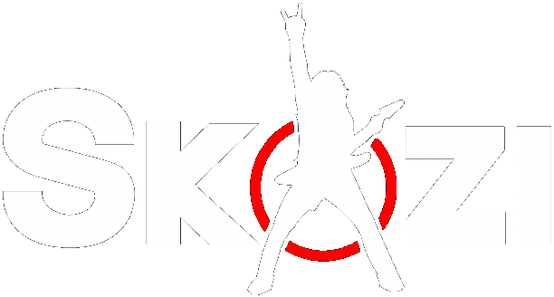

<div align="center">



# SKAZI Bundle

All SKAZI plugins by Asher Swissa in one place, and one installer for all of them.  
Every plugin uses the vendor name **SKAZI**, so DAWs list them together.

[](https://github.com/slazoasher/skazi-bundle/releases/latest)
[](https://github.com/slazoasher/skazi-bundle/releases/latest)
[](https://github.com/slazoasher/skazi-bundle)
[](https://github.com/slazoasher/skazi-bundle)

</div>

---

## 🎛️ What's Inside

<|message|> Folder | Plugin | Type |
|---|---|---|
| `SKAZI-Synth` | **SKAZI** | Psy / acid / VA synth — Virus-style supersaw unison, analog drift, wavetables, 3,650 presets |
| `Bully` | **BULLY** | Wavetable monster — 3 osc, SHARP 24 filter, 462 presets |
| `TBON303` | **SKAZI 303** | Acid bass line synth — 544 presets incl. 32 HARD ACID |
| `Bamba` | **BAMBA** | Riser & uplift maker — 260 presets |
| `Tahini` | **TAHINI** | Space delay + reverb — 250 presets |
| `Subich` | **SUBICH** | Bass + sub bass synth — 1,000 presets |
| `Zhug` | **ZHUG** | Saturator + widener — 4× oversampled |
| `Salat` | **SALAT** | Glitch multi-FX + RISE — 104 presets |
| `Kickass` | **KICKASS** | Kick drum synth — 50 presets |
| `MidiGod` | **MIDI GOD** | MIDI pattern generator + audio to MIDI — 106 presets |
| `Kube` | **KUBE** | Psytrance wavetable synth — 106 presets |
| `Quazi` | **QUAZI** | 4-band distortion — 104 presets |
| `Shaksuka` | **SHAKSUKA** | Random chop & glitch FX — 509 presets |
| `PitaPump` | **PITA PUMP** | Sidechain LFO tool — 105 presets |
| `FilterFish` | **The FilterFish** | Filter FX — 800 presets |

`Common` holds the shared metal skin, knobs, preset bar and A/B code used by SUBICH, BAMBA, TAHINI, ZHUG, SALAT, MIDI GOD and QUAZI.

Plugin IDs (manufacturer + plugin codes) are unchanged, so existing DAW projects keep loading them.

---

<details>
<summary><b>📦 Adding a New Plugin</b></summary>

1. Put the plugin folder here with bundle-style CMake (JUCE 8.0.4, vendor **SKAZI**, AU on Mac).
2. Add it to `build_bundle.ps1`, `mac/build_mac.sh`, `mac/welcome.html`, `mac/Uninstall SKAZI Bundle.command`, `BundleInstaller/SetupMain.cpp` and a row at the end of the table above.
3. On the download page (`docs/index.html`), add its card **at the bottom of the list** (the newest plugin is always last; BULLY stays first) and update the plugin and preset counts.
4. Push to `main`. CI builds both installers and publishes them as the next release (v1.3, v1.4, …). The page's download buttons link to `releases/latest`, so they serve the new installer as soon as the release is up.

</details>

---

<details>
<summary><b>🪟 Build the Installer (Windows)</b></summary>

Needs Visual Studio 2022 (C++ workload), CMake and Git.

```powershell
powershell -ExecutionPolicy Bypass -File build_bundle.ps1
```

Output: `dist\SKAZI Bundle Setup.exe`, plus every plugin's VST3 and app in `dist\Plugins`.  
JUCE is downloaded automatically (8.0.4 and 8.0.15).  
`-PluginsOnly` builds just the plugins, `-InstallerOnly` re-packs the last built plugins.

<details>
<summary><b>What the Installer Does</b></summary>

- Lets you tick which plugins to install
- VST3s go to `C:\Program Files\Common Files\VST3\SKAZI\`
- Standalone apps go to `C:\Program Files\SKAZI\` with a SKAZI Start Menu folder
- Removes older separate installs of the same plugins (SKAZI 1.2, SHAKSUKA, The FilterFish) so nothing shows up twice
- Shows up as **SKAZI Bundle** in Windows "Add or remove programs"; the same exe uninstalls (`/uninstall`)
- `/silent` installs everything without a window

> ⚠️ The installer is not code-signed, so Windows SmartScreen shows "Windows protected your PC": click **More info, then Run anyway**.

</details>

</details>

---

<details>
<summary><b>🍎 Mac (OS X / macOS)</b></summary>

`mac/build_mac.sh` builds all plugins for Apple Silicon + Intel and makes **`dist/SKAZI Bundle.pkg`**:

- VST3 to `/Library/Audio/Plug-Ins/VST3/SKAZI/`
- Audio Units to `/Library/Audio/Plug-Ins/Components/` (Logic, GarageBand, Ableton)
- Apps to `/Applications/SKAZI/`, with **Uninstall SKAZI Bundle.command**

It must run on a Mac (`bash mac/build_mac.sh`). Without a Mac, push this folder to GitHub: `.github/workflows/build-bundle.yml` builds the Mac `.pkg` and the Windows `.exe` on GitHub's machines; download them from the run's **Artifacts**.

> ⚠️ The Mac installer is not signed with an Apple Developer ID, so the first time macOS blocks it: right-click the `.pkg`, choose **Open**, then **Open** again (or System Settings > Privacy & Security > Open Anyway).

Before pushing to GitHub, remove the `SKAZI-Synth/.git` folder from this copy (the full history stays in `Documents\ACIDANCE\ACIDANCE`), otherwise GitHub treats it as an empty sub-project.

</details>

---

<details>
<summary><b>🎨 Logo</b></summary>

Save the SKAZI logo as `Resources\skazi_logo.png` (and in each plugin's `Resources` folder) and rebuild; until then a drawn stand-in is used.

</details>

---

<div align="center">

*Built with JUCE 8 · VST3 / AU · Windows & macOS*

</div>